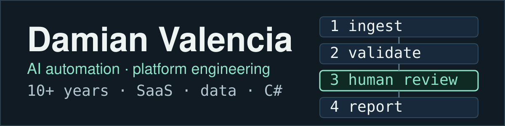

# Damian Valencia

  

**I build AI-powered engineering tools that make people and systems more effective.**

Software engineer with 10+ years of experience spanning enterprise software, data integrations, technical support leadership, and automation. Today, I'm building a resource-conscious ecosystem of AI agents and developer tools.

[Portfolio ↗](https://vision1224.github.io/) · [LinkedIn ↗](https://www.linkedin.com/in/damian-valencia-280727b6/) · [Work with me ↗](mailto:damianv2420@gmail.com)

## What I've delivered

| 10+ years in technology | 10+ hours saved per week | 200+ knowledge articles | 4 team members coached |
| :---: | :---: | :---: | :---: |
| Software, data and operations | Support-team workflow automation | Knowledge-base automation | Enterprise technical support |

Recent work includes AI assistants for two customer support portals, automated knowledge and operational workflows, enterprise data integrations with C# and SSIS, and investigation of complex production and API issues. I care about whether automation actually saves time, improves reliability, and makes someone's work easier.

## Building an AI-native engineering ecosystem

I'm exploring how existing software can become more useful to AI agents without wasting compute, tokens or engineering effort.

| Project | Engineering focus | Status |
| --- | --- | --- |
| **AgentTerminal** | Windows AI-native terminal workspace; Claude sessions, usage accounting, CPU/RAM metrics, Git context, automated tests and CI | Working private prototype |
| **AgentCareer** | Job discovery, factual document preparation and human-reviewed application workflows | In development (private) |
| **Multi-agent orchestration** | Planned research: coordinating agents with shared outcome tracking | Planned, not yet published |

Current priorities include resource-aware scheduling, reusable CLI/API adapters, automated evaluation and GitHub-based engineering workflows. I prefer extending proven open-source foundations to rebuilding capabilities that already exist. Private projects will be shown through sanitized examples only.

## Public repositories

Verified automatically from public GitHub metadata by [`scripts/update_profile.py`](scripts/update_profile.py). Only repositories listed in the script are shown, each with a hand-written status label.

<!-- PROJECTS:START -->
| Project | Status | About | Last push |
| --- | --- | --- | --- |
| [**ConnectFour**](https://github.com/Vision1224/ConnectFour) | Original (Java, OOP) | Java Connect Four built around OOP and game logic | 2022-04-13 |
| [**Blackjack**](https://github.com/Vision1224/Blackjack) | Original (Java, OOP) | Terminal Blackjack built in Java with object-oriented design | 2022-04-13 |
| [**Malloc**](https://github.com/Vision1224/Malloc) | Original (C, memory allocator) | Custom memory allocator in C simulating low-level memory management | 2016-09-23 |
| [**loan_approval_predictor**](https://github.com/Vision1224/loan_approval_predictor) | Demo (Flask + ML model) | Flask API serving a simple machine-learning loan-approval model | 2025-06-27 |
| [**docker-fundamentals**](https://github.com/Vision1224/docker-fundamentals) | Learning repo (fork) | Docker Fundamentals | 2023-12-28 |
| [**azure-devops-aks-kubernetes-terraform-pipeline**](https://github.com/Vision1224/azure-devops-aks-kubernetes-terraform-pipeline) | Learning repo (fork) | Provision AKS Cluster using Azure DevOps Pipelines | 2023-05-19 |
<!-- PROJECTS:END -->

## My engineering toolkit

| | |
| --- | --- |
| **AI & automation** | Claude Code, ChatGPT, Cursor, MCP, n8n, Python, PowerShell |
| **Software & integrations** | C#, .NET, JavaScript, TypeScript, Node.js, REST, SOAP, GraphQL |
| **Data engineering** | SQL Server, PostgreSQL, SSIS, SQLite, ETL, query optimization |
| **Platform & operations** | Azure, AWS, Docker, Kubernetes, Terraform, Linux, GitHub Actions |
| **Enterprise engineering** | Zendesk, Salesforce, Confluence, Jira, Splunk, Databricks, New Relic |

## Let's work together

I'm available for full-time and contract work in **AI automation, applied AI, platform engineering, software engineering, and technical integrations**.

I can help your team reduce manual operations, connect systems, build internal tools, and deliver measurable automation.

B.S. Computer Science, The University of Texas at El Paso (May 2016) · El Paso, Texas

[View my portfolio](https://vision1224.github.io/) · [Contact me](mailto:damianv2420@gmail.com)
